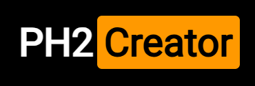

  

<h1 align="center">PH2 Mod Studio</h1>

  <b>Build, test and share mods for Perfect Heist 2, without needing to be a programmer.</b>

  
  &nbsp;
  
  &nbsp;
  

---

## What is it?

PH2 Mod Studio is a desktop app for making mods for **Perfect Heist 2**. Drag blocks together to build what your mod does, or write Lua if you prefer. The app checks your work as you go, explains problems in plain English, and packs everything up so it is ready for the game.

> **Unofficial.** This is a fan-made tool. It is not made by, or affiliated with, the developers of Perfect Heist 2.

## What you can do with it

| | |
|---|---|
| **Visual Builder** | Make a mod by connecting blocks (nodes), like a flowchart. Every group has its own colour, so Logic, Math, Movement, Weapons and the rest are easy to tell apart. Undo and redo as much as you like. |
| **Code Studio** | A proper Lua editor with suggestions, hover help and one-click fixes. Mistakes are explained in everyday words. |
| **Design Studio** | Lay out on-screen text, images and sounds with a live preview. |
| **Game API Explorer** | Every game feature the app knows about, and how sure it is of each one. |
| **Testing** | One button runs every check the app can do and tells you exactly what only the real game can confirm. |
| **Export** | Packs your mod into a brand-new folder. It never overwrites anything. |
| **In-Game Manager** | A small in-game menu for managing installed mods (opens with Right Shift by default). |
| **Tutorial** | A short guide to the Visual Builder and the little Lua you need to know. |
| **AI assistant (optional)** | Add your own API key for Claude, OpenAI, Gemini and others, then describe what you want. The AI proposes a graph or script; you review it before anything changes. |

## Install

1. Open the **[latest release](../../releases/latest)** and download `PH2 Mod Studio Setup ... .exe`.
2. Run it. Windows may show a blue **"Windows protected your PC"** box, because the app is not signed with a paid certificate yet. Click **More info**, then **Run anyway**. (If Windows blocks it with no such button, see the questions at the bottom.)
3. Open **PH2 Mod Studio** from the Start menu.

You never need to download updates by hand. See below.

## Your first mod in five minutes

1. **Create Mod**: give it a name and a short description.
2. Open **Visual Builder**. A new graph starts with an event, like "a round starts".
3. Click blocks in the list on the left to add them, then drag wires between the dots.
4. Fix anything marked red. Yellow is only a warning.
5. Open **Testing**, then export.

The **Tutorial** page inside the app walks through all of this step by step, plus a five-minute Lua primer.

## Automatic updates

When a new version is released, the app downloads it quietly in the background and shows a small notice. Click **Restart now** to install it, or just keep working: it installs the next time you close the app. Your mods are never touched by an update. You can turn the check off in **Settings**.

## Honest about what is known

The game does not publish a mod API, so everything is labelled by how sure the app is:

- **Confirmed**: known to exist in the game.
- **Experimental**: found in the game's files or in a working mod, but not tested here. Try it in the game before relying on it.
- **Unknown / Unsupported**: not found, so the app does not pretend it works.

Testing features (money, ammunition and the Gameplay Lab) are for trying things in your own private game, and are blocked when you export in **Release** mode. This tool is not for cheating against other players, and it has no aimbots, hidden-information tricks or anti-cheat workarounds.

## Privacy

- Your mods stay on your computer, in `Documents\PH2 Mod Studio`.
- The app contacts GitHub only to look for updates.
- The AI assistant is **off until you add a key**, and nothing is sent until you press Send. API keys are encrypted on your PC and never leave it except to go to the provider you chose.

## Questions

**Windows says the app is unsafe.** It is unsigned for now, and the warning appears for every unsigned app. Use **More info → Run anyway**.

**Windows says "An Application Control policy has blocked this file."** Windows 11's *Smart App Control* blocks unsigned apps it does not recognise, and it has no "Run anyway" button. Turn it off in **Windows Security → App & browser control → Smart App Control settings**. Note that Windows only lets you turn it back on by reinstalling Windows, so only do this if you are comfortable with that. A signed version that avoids this is planned.

**Will updating delete my mods?** No. Mods live in your Documents folder, separate from the app.

**Does it work on Mac or Linux?** Not yet. Windows only.

**Something broke.** Open an issue on this page and say what you were doing and what you expected.

---

Made for the Perfect Heist 2 community.

